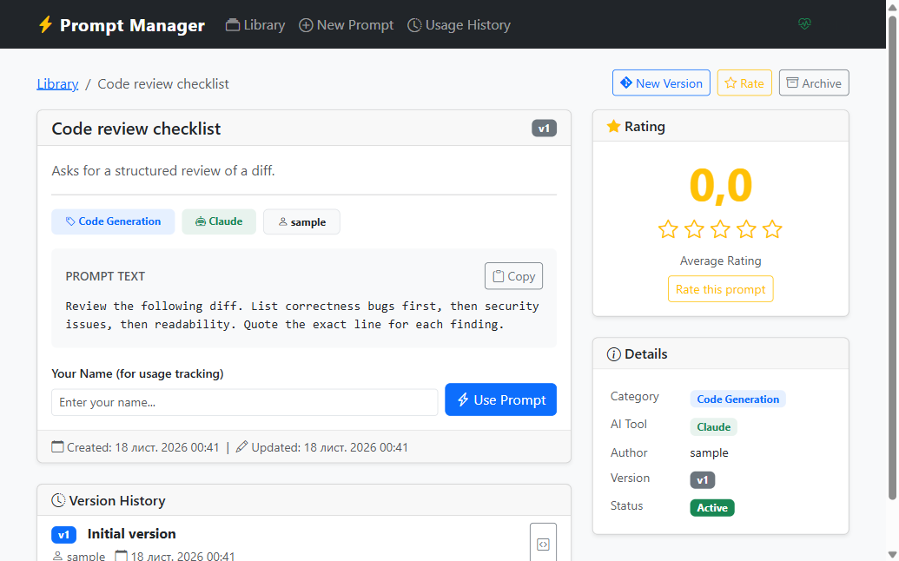
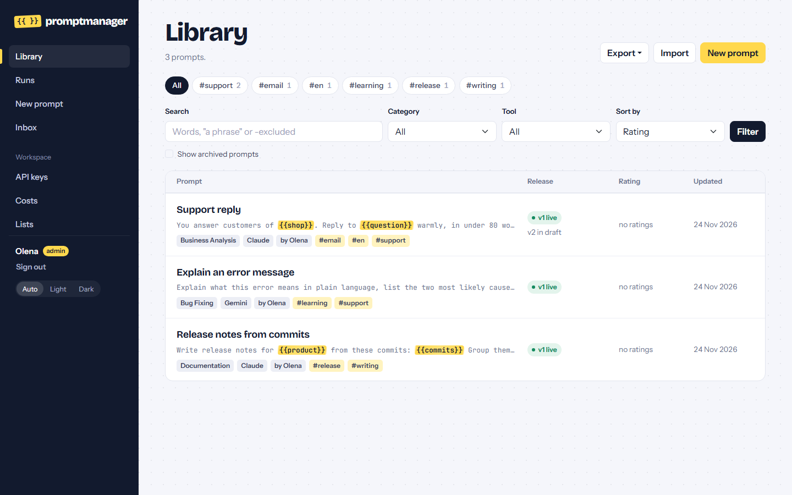
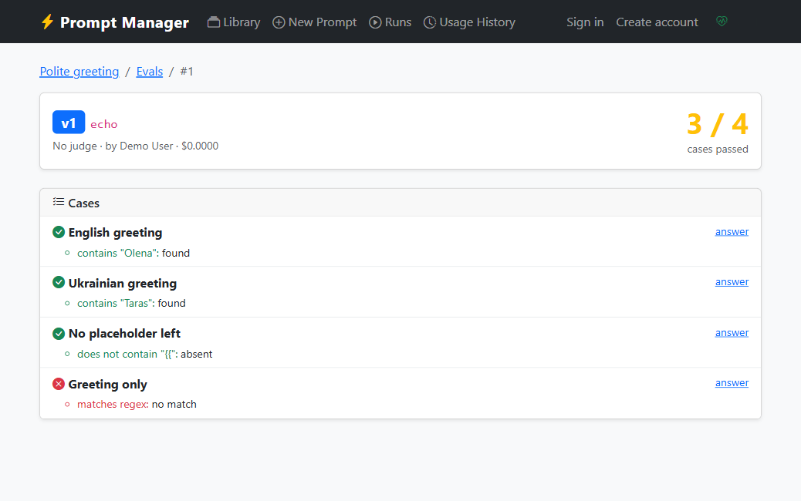
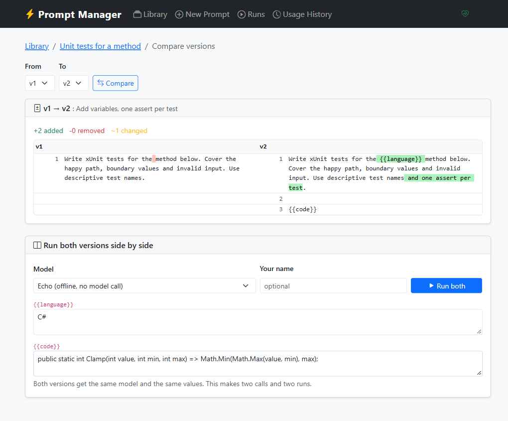
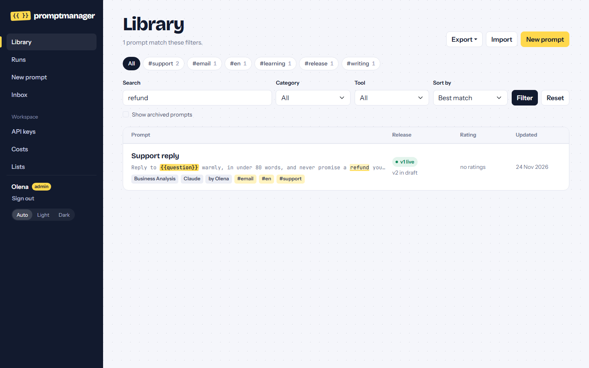
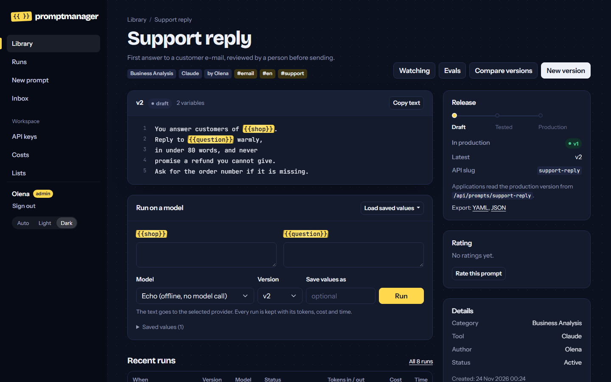
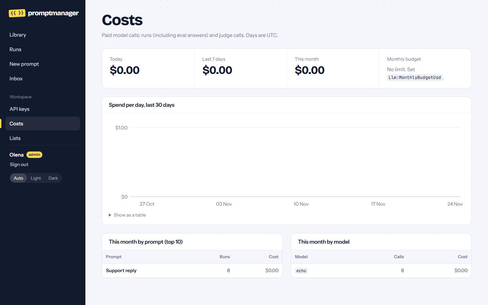
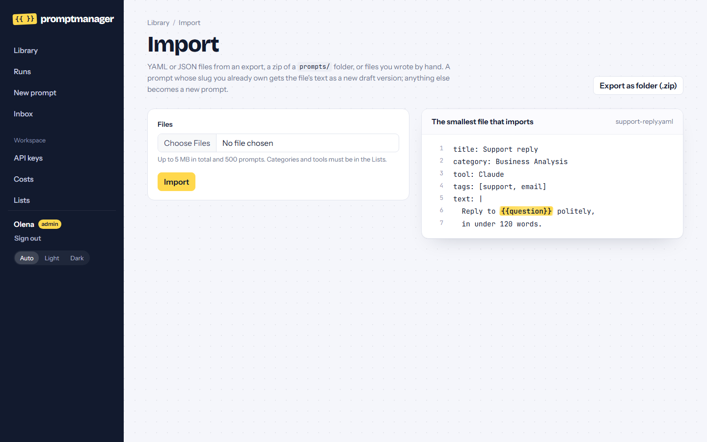
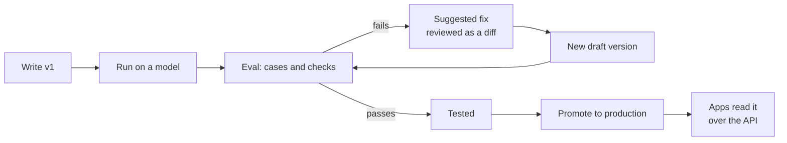
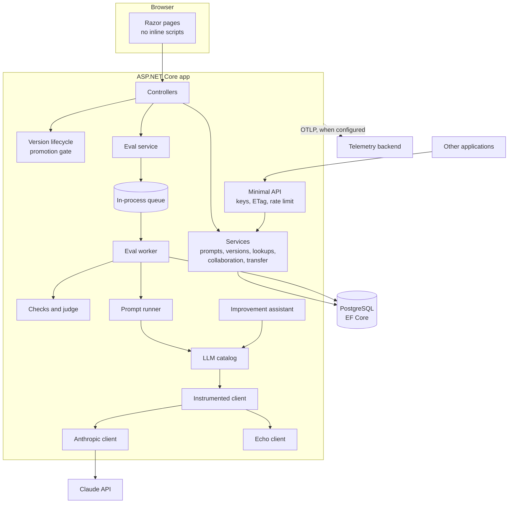

# Prompt Manager

[](https://github.com/Heek1/AI-Prompt-Management-System/actions/workflows/ci.yml)
[](LICENSE)

A self-hosted web app for a team's AI prompts: write a prompt once, improve it
in versions, test every version against cases before it ships, and let
applications fetch the version that passed over an API.

Built with ASP.NET Core 10 MVC, EF Core 10 and PostgreSQL.
**Live demo:** https://prompt-manager-bt5r.onrender.com (free plan: the first
request after a quiet spell takes a while; no API key is set there, so only the
offline echo model runs).



| Library with collections | Eval run: one cell per case |
|---|---|
|  |  |
| **Version diff** | **Search with marked matches** |
|  |  |
| **Run result** | **Dark theme** |
|  |  |
| **Costs** | **Import** |
|  |  |

## The workflow



A version that does worse on its evals than the one in production cannot be
promoted; only an admin can override that, and the override is recorded.

## What it does

**Prompts**
- **Versions.** Each change of the text is a new numbered version with a change
  note; title, description, category, tool and tags change without one. The
  history stays visible, with a word-level diff between any two versions.
- **Statuses.** Draft, tested (passed every case of an eval) and production.
  Promoting, or rolling back to an older version, is refused when its evals are
  worse than production's on the same model.
- **Variables.** `{{name}}` in a prompt becomes a field when you run it. Values
  can be saved as named input sets.
- **Tags and collections.** Free-form tags (any script, up to 8 per prompt);
  the library lists the tags in use with counts and filters by them.
  Categories and tools are lists that admins edit on the **Lists** page.
- **Search.** PostgreSQL full-text search over title, description and text,
  ranked with the title weighted highest, with web-search syntax (`"a phrase"`,
  `-excluded`) and the matching words marked in the results.
- **Import and export.** The library or one prompt as YAML or JSON, with
  versions, tags and eval cases, or a zip with one YAML file per prompt for a
  folder in a git repository. Importing a changed file for a prompt you own
  adds its text as a draft version.
- **Comments and inbox.** Comments on each version; new versions, promotions
  and comments on prompts you watch arrive in an in-app inbox.
- **Ratings** from 1 to 5, one per account per prompt; archive, restore, delete.

**Models and tests**
- **Runs.** Run any version on Claude (official Anthropic .NET SDK) or on the
  offline *echo* model. Every run keeps the exact text sent, the answer, status
  (succeeded, truncated, refused, failed), tokens, cost and duration.
- **Evals.** Test cases with variable values and checks: must or must not
  contain, a regular expression, a JSON Schema, or a rubric graded by a judge
  model. Evals run in a background queue, keep every answer, and show how the
  version compares with the previous one on the same model.
- **Prompt-injection check.** One click adds six standard attacks as cases
  (instruction override, "developer mode", asking for the prompt, a fake end of
  input, another language, a base64-encoded order); a case passes when the
  answer has neither a fresh random canary nor a piece of the prompt.
- **Suggested fixes.** On a failed eval, a model reads the failed cases, their
  answers and the failed checks, and proposes a revision. You review it as a
  diff and can edit it; accepting saves a draft and reruns the same eval.
- **Model comparison.** The same version and cases on two to four models, with
  pass rate, cost, tokens and answer time side by side.
- **Costs.** Spend today, this week and this month, a 30-day chart, and spend by
  prompt and model; `Llm:MonthlyBudgetUsd` caps paid calls per month.

**For applications**
- **HTTP API** with keys: the production (or latest, or a given) version of a
  prompt by slug, or its text with variables filled in. ETags, a rate limit and
  an OpenAPI description. See [API](#api).

**Running it**
- English and Ukrainian interface: the browser's language, or the EN / UA
  switch in the sidebar (dates follow the language; numbers stay en-GB).
- Light and dark theme (follows the system, or a choice kept in the browser),
  a layout that works on a phone, keyboard focus marks.
- Health checks, structured JSON logs, and OpenTelemetry traces and metrics.

## What it does not do (yet)

- **Only Claude is wired in.** Other providers need their own `ILlmClient`.
- **Suggested fixes have only been tested with a scripted model.** The live
  instance has no API key, and the automated tests do not call a real model.
  The real Anthropic path is tested against a stubbed HTTP handler.
- **Single runs happen inside the web request** (up to `Llm:TimeoutSeconds`).
  Evals use an in-process queue: an eval interrupted by a restart is marked
  failed, and the queue does not spread over several instances.
- **The monthly budget is checked before each paid call**, so the call that
  crosses it still completes.
- **Prices are configuration** and must be kept up to date by hand.
- **No e-mail.** There is no e-mail confirmation, password reset or e-mail
  notification; the inbox is in the app only.
- **Search is lexical.** Semantic (embedding) search is not built.
- **Git sync is manual:** export the folder, commit, edit, import. Nothing
  watches a repository.
- **Accessibility has not been audited.** The colours were chosen for contrast
  by eye, not measured against WCAG AA.
- **Ukrainian covers the interface, not every message.** Pages, buttons,
  form errors and the main notices are translated; messages built deeper in
  the services (eval check details, some refusals) and account errors from
  ASP.NET Core Identity stay English.

## Run it

Requires the [.NET 10 SDK](https://dotnet.microsoft.com/download) and Docker
(for PostgreSQL).

```bash
docker compose up -d db                  # PostgreSQL 17 on localhost:5433
dotnet run --project src/PromptManager
```

Open http://localhost:5139. The database is migrated on start, and in
Development three sample prompts are added to an empty database.

### Accounts and admins

Anyone can browse the library, runs and evals. Creating, rating, commenting
and running need an account (ASP.NET Core Identity). A prompt can be changed
only by its author or an admin. Admins are chosen in configuration: an account
registered with an address in `Auth:AdminEmails` gets the Admin role.

```bash
dotnet user-secrets --project src/PromptManager set "Auth:AdminEmails:0" "you@example.com"
```

`Llm:PaidModelsAccess` decides who may use models that cost money: `Admins`
(the default, so a public instance cannot spend your API credit) or `Everyone`.

### Running prompts on Claude

Without a key only the *echo* model is available, which returns the prompt it
was given. To use Claude:

```bash
dotnet user-secrets --project src/PromptManager set "Anthropic:ApiKey" "<your key>"
```

Models, prices, the default model and the timeout are in the `Llm` section of
[`appsettings.json`](src/PromptManager/appsettings.json).

### With Docker

```bash
docker compose up --build
```

The app and PostgreSQL; open http://localhost:8080. Data-protection keys are
stored in the database, so the app container is stateless.

### Observability

Logs are JSON outside Development, one line per request with method, path,
status and duration (no query string, headers or client IP). Traces and
metrics (ASP.NET Core, HttpClient, Npgsql, and every model call with its
tokens and cost, never its text) are exported over OTLP when
`OTEL_EXPORTER_OTLP_ENDPOINT` is set, for example to an OpenTelemetry
collector, Grafana Cloud or Honeycomb.

### Deploy: Render + Supabase

The live instance runs the Docker image on Render (free plan, Frankfurt) with
PostgreSQL on Supabase (free plan, eu-central-1). [`render.yaml`](render.yaml)
is the Render Blueprint and asks for `ConnectionStrings__DefaultConnection`,
`Auth__AdminEmails__0` and, optionally, `ANTHROPIC_API_KEY`.

- The app uses its own login role and schema on Supabase, not `postgres` and
  `public`, because Supabase exposes `public` through its REST API:

  ```sql
  create role promptmanager with login password '<generated>' noinherit;
  grant promptmanager to postgres;
  create schema promptmanager authorization promptmanager;
  alter role promptmanager set search_path = promptmanager;
  ```
- Render cannot reach Supabase's IPv6-only direct host, so the connection goes
  through the **session** pooler on port 5432 with the user name
  `<role>.<project-ref>`. The transaction pooler (6543) does not suit the
  app's prepared statements.
- Migrations run when the app starts. Free plans sleep: Render after 15 idle
  minutes, Supabase after a week without activity.

## API

Create a key under **API keys** (shown once; only its hash is stored), then:

```bash
# The production version (?label=latest for the newest, ?version=3 for a specific one)
curl -H "X-Api-Key: pm_..." https://<host>/api/prompts/support-reply

# The text with {{variables}} filled in (no model is called)
curl -H "X-Api-Key: pm_..." -H "Content-Type: application/json" \
     -d '{"variables": {"shop": "Northwind Books", "question": "Where is my order?"}}' \
     https://<host>/api/prompts/support-reply/render
```

```json
{
  "slug": "support-reply",
  "title": "Support reply",
  "version": 1,
  "status": "production",
  "text": "You answer customers of {{shop}}.\nReply to {{question}} politely, ...",
  "variables": ["shop", "question"],
  "updatedAt": "2026-11-24T00:24:00Z"
}
```

Responses carry an `ETag` for cheap `304` revalidation; each key may make 60
requests per minute; errors are `application/problem+json`; the OpenAPI
description is at `/openapi/v1.json`.
[`examples/PromptClient`](examples/PromptClient) is a small console app that
reads its prompt from here, and an integration test runs it against the app.

## Tests

```bash
dotnet test
```

Docker must be running: every database test uses real PostgreSQL in a
container ([Testcontainers](https://dotnet.testcontainers.org/)), migrated
once into a template database that each test copies.

- **303 unit and integration tests** in
  [`tests/PromptManager.Tests`](tests/PromptManager.Tests): services,
  concurrency (a competing write injected between read and save), validation,
  the Anthropic SDK against a stubbed handler, the runner, every eval check,
  the background worker, suggestions with a scripted model, authorization for
  anonymous visitors, authors, other users and admins, import and export round
  trips, and the app through `WebApplicationFactory` with real forms.
- **4 browser tests** in [`tests/PromptManager.E2E`](tests/PromptManager.E2E):
  Playwright drives headless Chromium against the app on Kestrel through the
  main flow (write, run, eval, new version, diff, promote), search and
  collections, the copy button and confirm dialogs, the phone menu and the
  theme. Any console error fails a test, which catches CSP violations.
  Install the browser once with
  `pwsh tests/PromptManager.E2E/bin/Debug/net10.0/playwright.ps1 install chromium`.

CI builds with `-warnaserror`, runs both suites, publishes a coverage summary
on each run (89.9% of lines and 77% of branches on the last run, generated
migrations excluded), and starts the Docker image with PostgreSQL.

The screenshots above come from a seeded demo in the browser tests:

```bash
PM_SCREENSHOTS=docs/images dotnet test tests/PromptManager.E2E --filter Screenshots
```

It also writes a screen recording, `docs/images/demo.webm`, which is not
committed.

## How it is built



```
src/PromptManager/
  Controllers/      MVC pages: prompts, runs, evals, lists, transfer, inbox, keys, costs
  Api/              The prompt API and API keys
  Services/         Prompts, lookups, tags, collaboration, costs, runner, transfer
  Evals/            Checks, judge, executor, worker, injection pack, assistant
  Llm/              ILlmClient, Anthropic and Echo clients, catalog, telemetry
  Data/ Models/ DTOs/ ViewModels/ Views/
  Infrastructure/   Field limits, templates, diff, slugs, tag names, prompt markup
  Migrations/       EF Core migrations (applied at startup)
tests/PromptManager.Tests/   unit and integration tests
tests/PromptManager.E2E/     browser tests and the screenshot script
examples/PromptClient/       a client that reads prompts over the API
```

### Design decisions

- **PostgreSQL everywhere.** Development, tests and deployment use the same
  database, so there is one set of migrations and no provider differences
  hiding in tests. Full-text search uses PostgreSQL's own `tsvector` with the
  `simple` configuration: prompts mix English and Ukrainian, and a stemmer for
  one language mangles the other.
- **The database guards concurrency.** A unique index on
  `(PromptId, VersionNumber)` and an optimistic concurrency token make
  simultaneous edits produce consecutive versions; a unique index is the only
  guard against double ratings, so there is no check-then-insert window.
- **Evals gate releases.** Promotion compares the version's latest eval with
  production's on the same model. Suggested fixes go through the same gate:
  accepting one saves a draft and reruns the eval, so a model's revision is
  never trusted without the checks.
- **Providers behind one small interface.** `ILlmClient` only translates a
  prompt into a provider call and back. Timing, cost and storage live in the
  runner, and telemetry in one wrapper, so every model is measured the same way.
- **A failed call is still a run**, because it was made and may have cost
  money. Suggestions are stored as runs for the same reason, which also lets
  the review page reload without calling the model again.
- **Model answers are data.** Injection-case answers and judge inputs are
  wrapped in tags and called data in the prompts that read them, because they
  may contain instructions aimed at the judge or the assistant.
- **No inline scripts.** The Content Security Policy allows scripts from the
  app only; behaviour hangs off `data-` attributes in one script file, and the
  browser tests fail on any CSP violation.
- **Warnings are errors**, including NuGet vulnerability audits
  ([`Directory.Build.props`](Directory.Build.props)).

More on why versions and evals are built this way:
[Versioning and testing prompts like code](docs/versioning-and-evaluating-prompts.md).

## How it compares

| | This project | [Langfuse](https://langfuse.com) | [promptfoo](https://www.promptfoo.dev) | [PromptLayer](https://www.promptlayer.com) |
|---|---|---|---|---|
| What it is | Web app: prompt library with versions, runs, evals and an API | Open-source LLM engineering platform: tracing, prompt management, evaluations | Open-source CLI and library for testing prompts and red-teaming | Hosted platform: prompt registry, request logging, evaluations |
| Where prompts live | In the app (PostgreSQL), fetched over HTTP; YAML export for git | In the platform, fetched through its SDKs | In config files in your repository | In the platform |
| Observing production traffic | No: only runs started from the app | Yes, tracing is its core | No | Yes, request logging |
| Gating a release on eval results | Yes: a version that does worse than production cannot be promoted without an admin | Not as a built-in promotion rule | Yes, by failing a CI run | Through its own evaluation features |

Use this project to see how such a workflow fits together in a few thousand
lines of C#, or as a starting point for a team that wants a small self-hosted
tool. For tracing production traffic or many providers, the tools above go much
further.

## License

[MIT](LICENSE)
