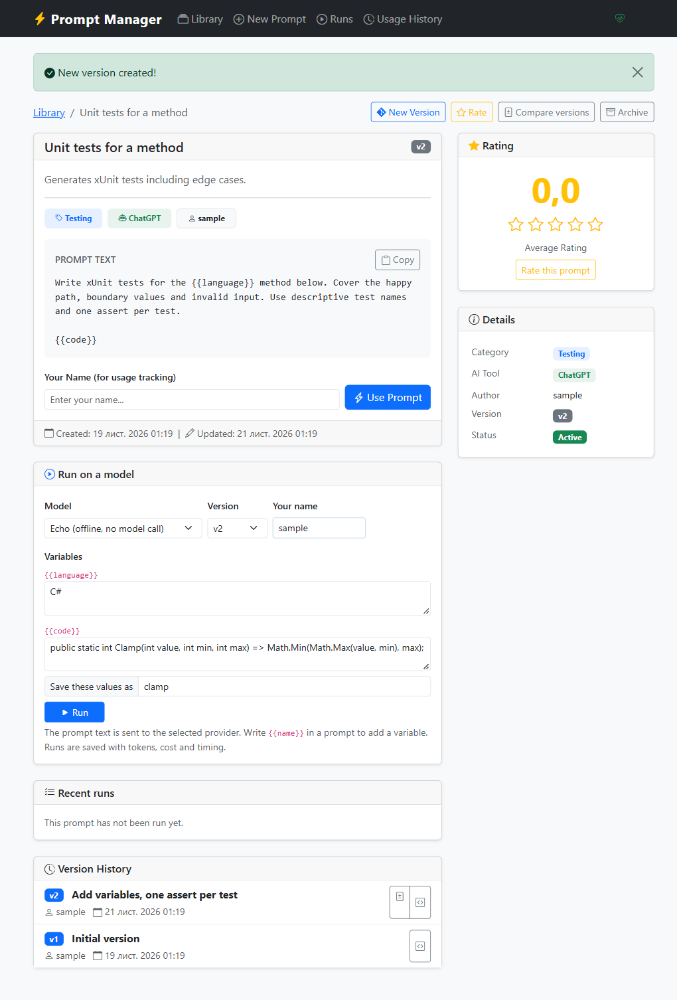
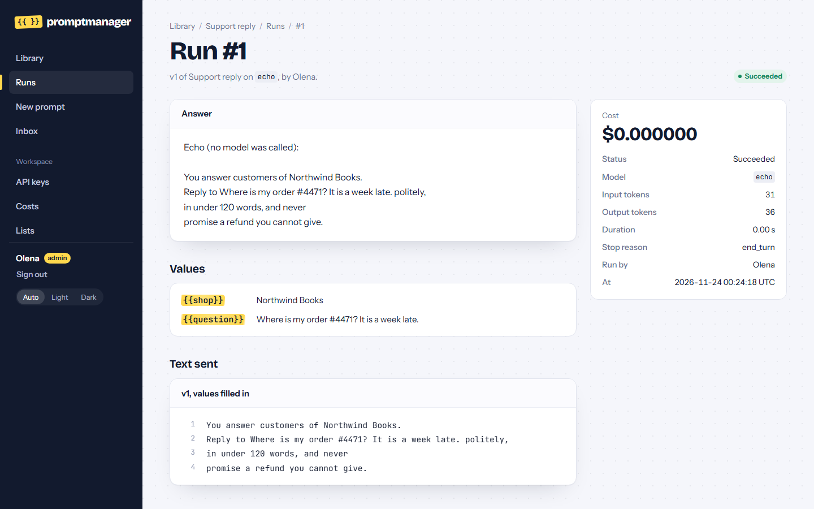
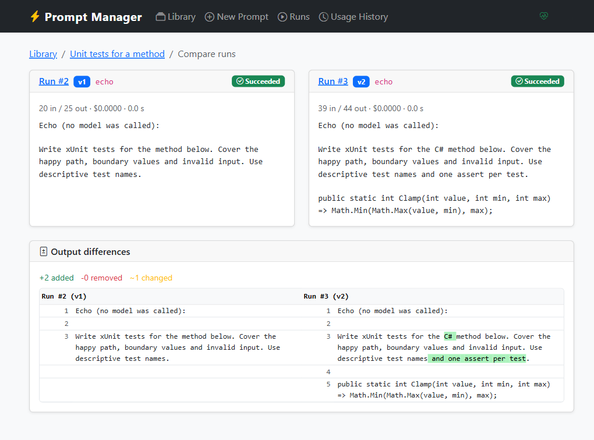

# Prompt Manager

[](https://github.com/Heek1/AI-Prompt-Management-System/actions/workflows/ci.yml)
[](LICENSE)

A web app for keeping a team's AI prompts in one place and checking how they
behave: write a prompt, improve it in versions, run any version on a model,
compare versions side by side, and keep every run with its tokens, cost and
timing.

Built with ASP.NET Core 10 MVC, EF Core and PostgreSQL.

| Library | Prompt details |
|---|---|
|  |  |
| **Run with variables** | **Run result** |
|  |  |
| **Eval results** | |
|  | |
| **Version diff** | **Two versions side by side** |
|  |  |

## What it does

- **Library** with search over title, description and prompt text,
  filters by category and AI tool, and sorting by rating, date, title or version.
- **Versions.** Each edit creates a new numbered version with a change note.
  The full history stays visible.
- **Run on a model.** Run any version on Claude (through the official
  Anthropic .NET SDK) or on the offline *echo* model. Each run stores the exact
  text sent, the answer, status (succeeded, truncated, refused, failed),
  tokens, cost and duration; `/Runs` lists them all.
- **Variables.** Write `{{name}}` in a prompt and the Run form asks for a
  value. Values can be saved as named *input sets* and reused.
- **Evals.** Give a prompt test cases: variable values plus checks (must or
  must not contain, a regular expression, a JSON Schema, or a rubric graded by
  a judge model). Run any version on any model; the eval runs in the
  background, keeps every answer as a run, and flags a version that passes
  fewer cases than the previous one on the same model.
- **Compare models.** Run the same version and cases on two to four models
  and see pass rate, cost, tokens and average answer time side by side.
- **Version statuses.** Draft, tested (passed all cases of an eval) and
  production. Promoting a version, or rolling back to an older one, is refused
  when its evals are worse than production's on the same model; only an admin
  can override that, and the override is recorded.
- **Costs.** Admins see spend today, over 7 days and this month, a daily chart
  for the last 30 days, and spend by prompt and by model (judge calls
  included). `Llm:MonthlyBudgetUsd` caps paid calls per UTC month.
- **HTTP API.** Applications fetch the production version of a prompt by its
  slug, or fill in its variables, with an API key. See [API](#api).
- **Compare versions.** A side-by-side diff with changed words highlighted,
  and a button that runs both versions on the same model and inputs, then
  shows the two answers and their differences.
- **Ratings** from 1 to 5 with an optional comment, one per user name per prompt.
- **Archive.** Archived prompts can no longer be edited or used.
- **Health checks.** `/health/live` (the process answers) and `/health/ready`
  (the database answers); `/health` is the same as ready.

## What it does not do (yet)

Known limitations:

- **Only Claude is wired in.** Other providers (OpenAI, Gemini) need their own
  `ILlmClient`; the interface is ready for them.
- **Single runs happen inside the web request** (up to `Llm:TimeoutSeconds`,
  180 s by default). Evals use an in-process background queue, which is lost
  if the app restarts mid-eval (the eval is then marked failed with its
  partial results) and does not spread over several app instances.
- **The monthly budget is checked before each paid call**, so the call that
  crosses it still completes; with several calls at once the overshoot can be
  a few calls.
- **Prices are configuration.** Cost is computed from the per-million-token
  prices in `appsettings.json`, which must be kept up to date by hand.
- **The real Anthropic API path has not been exercised by the automated
  tests**: they drive the SDK against a stubbed HTTP handler.
- **No e-mail confirmation or password reset yet.** Accounts work right after
  registration, and there is no admin page for managing users and roles.
- Categories and AI tools are fixed lists in
  [`Constants.cs`](src/PromptManager/Infrastructure/Constants.cs).

## Run it

Requires the [.NET 10 SDK](https://dotnet.microsoft.com/download) and Docker
(for PostgreSQL).

```bash
docker compose up -d db                  # PostgreSQL 17 on localhost:5433
dotnet run --project src/PromptManager
```

Open http://localhost:5139. On start the database is migrated, and in
Development three sample prompts are added to an empty database. The local
connection string is in `appsettings.Development.json`; it only works with the
database from `compose.yaml`.

### Accounts and admins

Anyone can browse the library and runs. Creating, rating and running need an
account (e-mail and password, ASP.NET Core Identity). A prompt can be edited,
versioned, archived, restored or deleted only by its author or an admin.

Admins are chosen in configuration, never in the UI: an account registered
with an address listed in `Auth:AdminEmails` gets the Admin role.

```bash
dotnet user-secrets --project src/PromptManager set "Auth:AdminEmails:0" "you@example.com"
```

`Llm:PaidModelsAccess` decides who may run models that cost money: `Admins`
(the default, so a public instance cannot spend your API credit) or
`Everyone` (the Development setting). The offline echo model is open to every
signed-in user.

### Running prompts on Claude

Without a key only the offline *echo* model is available, which returns the
prompt it was given. To use Claude, set an API key with user secrets (or the
`ANTHROPIC_API_KEY` environment variable):

```bash
dotnet user-secrets --project src/PromptManager set "Anthropic:ApiKey" "<your key>"
```

Models, prices, the default model and the timeout are in the `Llm` section of
[`appsettings.json`](src/PromptManager/appsettings.json). `Anthropic:Effort`
(default `high`) sets the reasoning effort, and `Anthropic:UseRefusalFallbacks`
(default `true`) lets the API re-serve a refused request with a fallback
model; the run then shows which model answered.

### With Docker

```bash
docker compose up --build
```

This starts the app and PostgreSQL. Open http://localhost:8080. Data is kept in
the `prompt-db` volume. The data-protection keys (sign-in cookies, form
tokens) are stored in the database too, so the app container is stateless.
Pass a key with `ANTHROPIC_API_KEY=<key> docker compose up`, and set
`ASPNETCORE_ENVIRONMENT=Development` to get the sample prompts.

### Deploy: Render + Supabase

The live instance runs the Docker image on Render (free plan, Frankfurt) with
PostgreSQL on Supabase (free plan, eu-central-1).
[`render.yaml`](render.yaml) is the Render Blueprint; it asks for three values:
`ConnectionStrings__DefaultConnection`, `Auth__AdminEmails__0` and, optionally,
`ANTHROPIC_API_KEY`.

Database setup on Supabase:

- The app uses its own login role and schema, not `postgres` and `public`:
  Supabase exposes `public` through its REST API, and the app's tables
  (accounts, password hashes) must not be reachable there. The role's
  `search_path` points at its schema, so migrations and queries need no
  schema names.

  ```sql
  create role promptmanager with login password '<generated>' noinherit;
  grant promptmanager to postgres;
  create schema promptmanager authorization promptmanager;
  alter role promptmanager set search_path = promptmanager;
  ```
- Render cannot reach Supabase's direct (IPv6-only) host, so the connection
  goes through the Supavisor **session** pooler on port 5432, with the user
  name `<role>.<project-ref>`:
  `Host=aws-0-eu-central-1.pooler.supabase.com;Port=5432;Database=postgres;Username=promptmanager.<project-ref>;Password=...;SSL Mode=Require`.
  (The transaction pooler on 6543 does not suit the app's prepared statements.)
- Migrations run when the app starts.

The app also accepts `postgresql://` URLs, trusts Render's proxy headers
(`ASPNETCORE_FORWARDEDHEADERS_ENABLED`) so cookies are marked secure, and keeps
its keys in the database because free services have no persistent disk.

Free-plan limits: the Render service sleeps after 15 minutes without traffic
(the next request takes a while), and a free Supabase project is paused after
a week without activity.

## API

Create a key under **API keys** (it is shown once; only its hash is stored),
then:

```bash
# The production version (?label=latest for the newest, ?version=3 for a specific one)
curl -H "X-Api-Key: pm_..." https://<host>/api/prompts/support-reply-en

# The text with {{variables}} filled in (no model is called)
curl -H "X-Api-Key: pm_..." -H "Content-Type: application/json"      -d '{"variables": {"customer": "Olena", "topic": "a refund"}}'      https://<host>/api/prompts/support-reply-en/render
```

```json
{
  "slug": "support-reply-en",
  "title": "Support reply (EN)",
  "version": 2,
  "status": "production",
  "text": "Reply politely to {{customer}} about {{topic}}.",
  "variables": ["customer", "topic"],
  "updatedAt": "2026-11-22T21:40:00Z"
}
```

- Responses carry an `ETag`; send it back in `If-None-Match` to get a cheap
  `304` while the version is unchanged. `Cache-Control: no-cache` makes clients
  revalidate, so a promotion is picked up on the next request.
- Each key may make 60 requests per minute (`429` above that).
- Errors are `application/problem+json`; a missing or revoked key gets `401`.
- The OpenAPI description is at `/openapi/v1.json`.

## Tests

```bash
dotnet test
```

246 tests in [`tests/PromptManager.Tests`](tests/PromptManager.Tests):

- **All database tests use real PostgreSQL** in a container started by
  [Testcontainers](https://dotnet.testcontainers.org/), so Docker must be
  running. The schema is migrated once into a template database and every test
  gets its own copy, so tests are isolated and still fast.
- **Service tests** cover `PromptService`; unique indexes, transactions and
  search behave exactly as in the app.
- **Concurrency tests** inject a competing write between the service's read and
  its save, to check version numbering, duplicate ratings and archive-vs-edit.
- **Validation tests** for every form DTO.
- **LLM client tests** run the real Anthropic SDK against a stub HTTP handler
  and check the request it sends and how answers, refusals, truncation and
  errors are read.
- **Runner tests** cover variables, timeouts, cancellation, provider failures
  and cost.
- **Eval tests** cover every check type, judge replies, the executor, model
  comparison, and the full loop through the real background worker.
- **Authorization tests** cover anonymous visitors, authors, other users and
  admins, including attempts to spoof the author or owner in a form.
- **Integration tests** start the app with `WebApplicationFactory` and post real
  forms with antiforgery tokens.

CI ([`.github/workflows/ci.yml`](.github/workflows/ci.yml)) builds with
`-warnaserror`, runs the tests, and starts the Docker image with PostgreSQL
through `compose.yaml` on every pull request.

## How it is built

```
src/PromptManager/
  Controllers/      Prompts, History, Health, Home (redirect + error page)
  Services/         PromptService (prompts, versions, ratings, archive),
                    PromptRunner (runs), InputSetService
  Llm/              ILlmClient, Anthropic and Echo clients, model catalogue
  Evals/            Checks, judge, executor, background worker, eval service
  Data/             AppDbContext, DevDataSeeder
  Models/           EF entities
  DTOs/             Form and view DTOs with validation attributes
  Infrastructure/   Category and tool lists, field limits, templates, diff
  Migrations/       EF Core migrations (applied automatically at startup)
  Views/            Razor views, Bootstrap 5
tests/PromptManager.Tests/
```

### Design decisions

- **PostgreSQL everywhere.** Development, tests and deployment use the same
  database, so there is one set of migrations and no provider differences
  hiding in tests. (The project started on SQLite; its migrations were
  replaced by a single PostgreSQL one.)
- **Concurrency is handled by the database, not by checks in code.** A unique
  index on `(PromptId, VersionNumber)` and an optimistic concurrency token on
  `Prompt` make simultaneous edits produce consecutive versions (the service
  retries on conflict). A unique index on `(PromptId, UserName)` is the only
  guard against double ratings, so there is no check-then-insert window.
- **One source of truth for field limits.**
  [`FieldLimits`](src/PromptManager/Infrastructure/FieldLimits.cs) is used by
  both the form validation and the EF model.
- **Providers behind one small interface.** `ILlmClient` only translates a
  prompt into a provider call and back. Timing, cost and storage are done once
  in `PromptRunner`, so every model is measured the same way.
- **A failed call is still a run.** Provider errors and timeouts are stored as
  failed runs, because the call was made and may have cost money; only invalid
  input (unknown model, missing variable) is rejected without a record.
- **Warnings are errors**, including NuGet vulnerability audits of transitive
  packages ([`Directory.Build.props`](Directory.Build.props)).

## Roadmap

Next steps: a cost dashboard, a set of prompt-injection test inputs, an
assistant that proposes a better version from eval results, and a small example
application that reads its prompt through the API.

## License

[MIT](LICENSE)
